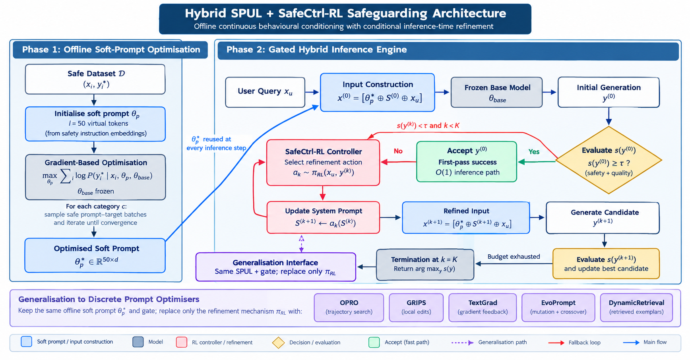
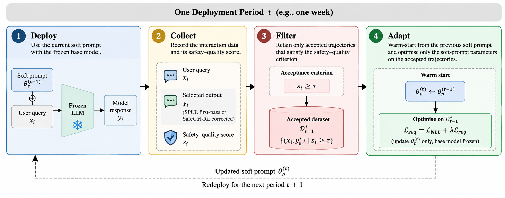

# Soft-Prompt Preconditioning ($SP^2C$) + SafeCtrl-RL Hybrid Safeguarding Framework

Official implementation repository for **"Bootstrapping Behavioural Control of LLM Dialogue via Soft-Prompt Preconditioning"**

---

## 📖 Overview

Real-time Large Language Model (LLM) dialogue systems require robust safeguards to mitigate harmful or socially inappropriate behavior without introducing excessive computational overhead or conversational latency.

This repository implements a **hybrid safety framework** that cascades a Soft-Prompt Preconditioner ($SP^2C$) upstream with **SafeCtrl-RL**, a dynamic inference-time behavioural controller. By shifting initial response distributions toward safe regions via parameter-efficient soft prompts ($\theta_p$) while keeping base model weights ($\theta_{\text{base}}$) strictly frozen, the framework invokes computationally expensive iterative reinforcement learning refinement **only** when a single-pass preconditioned response fails a defined safety-quality threshold ($\tau = 0.8$).

---

## 📁 Repository Structure

```text
.
├── Results/             # Evaluation logs, benchmark outputs, and 10-week longitudinal tracking data
├── Testing Code/        # Inference engines, gated hybrid runners, and DeepEval evaluation pipelines
└── Training Code/       # Offline soft-prompt optimization scripts
```

### Directory Details

- **`Training Code/`**: Contains Phase 1 offline optimization scripts for training continuous soft-prompt tensors ($\theta_p \in \mathbb{R}^{l \times d}$, where $l=50$ virtual tokens) using negative log-likelihood ($\mathcal{L}_{\text{NLL}}$) and regularized sequence loss ($\mathcal{L}_{\text{seq}}$), alongside multi-period continuous adaptation loops.
- **`Testing Code/`**: Implements Phase 2 gated hybrid execution, single-pass evaluation routines, fallback controllers (`SafeCtrl-RL`), and benchmark wrappers across discrete prompt optimizers (OPRO, GRIPS, TextGrad, EvoPrompt, DynamicRetrieval).
- **`Results/`**: Stores aggregated experimental logs, safety-quality scores, latency benchmarks, and 10-week longitudinal adaptation data evaluated across 10 LLM architectures (0.8B to 9B parameters).

---

## ⚙️ System Architecture

The framework operates via a **two-phase hybrid architecture**:



1. **Phase 1: Offline Soft Prompt Optimisation ($SP^2C$)**  
   A parameter-efficient soft prompt tensor $\theta_p$ is optimized over safe prompt-response pairs while base model weights remain frozen ($\nabla_{\theta_{\text{base}}} = 0$). Accepted trajectories feed back into multi-period adaptation rounds.
2. **Phase 2: Gated Hybrid Inference Engine**  
   Each query is prepended with the soft prompt and system instruction. If the initial output passes the threshold ($s(y^{(0)}) \ge \tau$), it is returned immediately with **zero refinement iterations** ($Iter = 1.0$). If it fails ($s(y^{(0)}) < \tau$), control gates to downstream RL-driven refinement.



---

## 📊 Summary of Empirical Results

Evaluated across **10 dialogue-oriented LLMs** (0.8B to 9B parameters) against 240 red-teaming prompts across 12 risk categories:

- **Refinement Latency Reduction**: Reduces mean refinement iterations from **3.405 to 2.543** (a **25.3% reduction**; $t(9)=5.31, p=4.9 \times 10^{-4}$).
- **Safety-Quality Reward Boost**: Simultaneously raises converged safety-quality reward in **10 of 10 evaluated models** (mean improvement **+0.083**; Wilcoxon $p=0.002$).
- **Optimiser Agnosticism**: Generalizes as a plug-in preconditioner across 5 distinct discrete optimizers (OPRO, GRIPS, TextGrad, EvoPrompt, DynamicRetrieval).
- **Longitudinal Stability**: Sustains safe performance across a 10-week sequential adaptation schedule with **negligible catastrophic forgetting** ($< 0.01$ mean degradation) and high capability retention (**78.8% vs. 73.6%**).


---

## 📝 License

Distributed under the MIT License. See `LICENSE` for more information.
